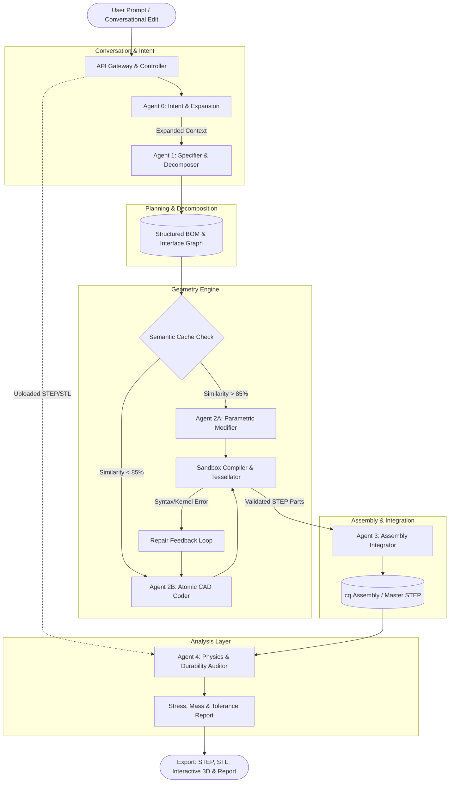

# Architectural Proposal: Hierarchical Multi-Agent CAD & Physics Engine

## 1. Executive Summary
This document outlines the evolutionary roadmap from Brepline's baseline atomic text-to-CAD generator to an enterprise-grade, multi-agent engine capable of decomposing complex natural-language requests into multi-part mechanical assemblies, enforcing manufacturing constraints, and conducting structural durability audits. 

To bridge the gap between vague human ideation and strict mechanical tolerances, an Intent Analyzer sits at the edge of the pipeline to expand sparse prompts and manage multi-turn conversational edits before mechanical decomposition begins.

---

## 2. System Architecture & Agent Roles



---

## 3. Detailed Agent Specifications

### Agent 0: Intent Analyzer & Prompt Enhancer

* **Input:** Raw, potentially sparse user input (e.g., *"make a gear"* or conversational follow-up *"make the teeth thicker"*), plus conversation history.
* **Role:** Acts as the Requirements Engineer. Evaluates the prompt for missing constraints. If a user asks for a gear, the agent expands this to specify missing parameters (module, pitch, bore size, thickness) based on standard mechanical defaults. For conversational edits, it isolates the delta (what changed) to selectively invoke the Modifier rather than regenerating from scratch.
* **Output:** A highly detailed, deterministic mechanical prompt mapped to a session ID.

---

### Agent 1: The Specifier & Decomposer

* **Input:** Expanded natural language prompt from Agent 0 (e.g., *"Design a scissor lift mechanism for a 5 kg load with 150 mm maximum stroke"*).
* **Role:** Acts as the Chief Mechanical Engineer. Deconstructs the prompt into:
1. **Bill of Materials (BOM):** List of discrete parts (Base, Links, Pins, Platform).
2. **Interface Contract:** Global shared variables ensuring mate compatibility:
```json
{
  "shared_interfaces": {
    "pin_diameter": 6.0,
    "hole_clearance": 6.2,
    "link_thickness": 4.0
  },
  "parts": [
    {"id": "link_arm", "qty": 4, "type": "plate_with_holes"},
    {"id": "pivot_pin", "qty": 6, "type": "pin"}
  ]
}
```
* **Output:** A Directed Acyclic Graph (DAG) of parts and mating references.

---

### Agent 2: Geometry Generation (Coder & Modifier)

* **Parametric Modifier (Cache Hit / Targeted Edit):** Takes pre-verified CadQuery scripts from Supabase `pgvector` (or the previous turn's output) and substitutes parameter values according to the Interface Contract.
* **Atomic Coder (Cache Miss):** Uses instruction-tuned models (e.g., Qwen2.5-Coder) with few-shot context to generate clean, single-solid CadQuery code.
* **Sandbox Verification:** Every component is executed through `runner.py` inside an OS-level isolated subprocess (`RLIMIT_AS` memory clamping). If OpenCascade fails, the traceback is routed back to the Coder for a maximum of 3 repair attempts.

---

### Agent 3: Assembly Integrator

* **Input:** Validated individual `.step` geometry files + Interface Contract from Agent 1.
* **Role:** Constructs an assembly tree using CadQuery's native `cq.Assembly()` API to position and mate the parts:
```python
import cadquery as cq

assy = cq.Assembly()
assy.add(base_plate, name="base", color=cq.Color(0.2, 0.2, 0.2))
assy.add(link_1, name="link_1", loc=cq.Location(cq.Vector(0, 0, 10)))
assy.save("master_model.step")
```
* **Output:** A unified multi-body `.step` file and a joint-hierarchy JSON tree for client-side Three.js visualization.

### Agent 4: Physics & Durability Auditor (Independent Service)

* **Input:** Assembled mechanism or user-uploaded CAD file (`.step`/`.stl`) + Material specifications.
* **Analysis Pipeline:**
1. **Geometric Diagnostics (Trimesh):** Checks for zero-thickness walls, degenerate facets, center of gravity (CoG), and bounding envelopes.
2. **Analytical Stress Checks:** Solves heuristic constraints—tensile and shear stress at connection points ($\sigma = F/A$, $\tau = F/A$), fastener shear margins against material yield strength, and thin-wall buckling checks.
3. **Durability Scorecard:** Outputs a safety factor ($SF = \frac{S_y}{\sigma_{\text{max}}}$) and flags high-risk geometric stress concentrators (sharp internal corners without fillets).